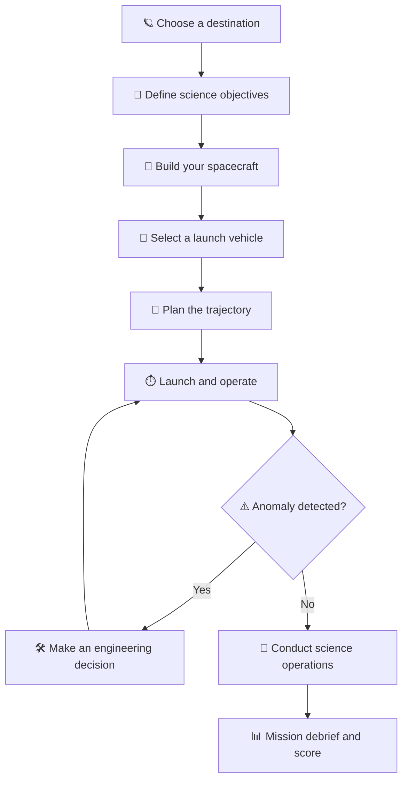

<div align="center">

<!-- Animated mission-control header -->


<h3>🚀 Educational Space Mission Design & Simulation Game</h3>

<p>
  
</p>

<p>
  <b>Developed for the NASA Space Apps Challenge</b><br/>
  Space Mission Design Game
</p>

<p>
  
  
  
  
</p>

<p>
  <a href="#-mission-brief">Mission Brief</a> ·
  <a href="#-mission-capabilities">Capabilities</a> ·
  <a href="#-get-mission-ready">Get Started</a> ·
  <a href="#-engineering-model">Engineering Model</a> ·
  <a href="#-data--acknowledgements">Data Sources</a>
</p>


</div>

## 🛰️ Mission brief

**MISSIONFORGE** is an interactive, browser-based space mission design and simulation platform. Step into the roles of **Spacecraft Mission Engineer** and **Mission Director**. Design, configure, launch, and operate robotic exploration missions across the Solar System.

This is more than choosing a destination and pressing *Launch*. Every component has a job, every kilogram matters, every watt has a purpose, and every mission decision can change the outcome.

> **Your objective:** build a spacecraft that can complete its scientific objectives while balancing engineering constraints, mission risk, resources, and budget.

## 🌌 Mission capabilities

<table>
<tr>
<td width="50%" valign="top">

### 🪐 Interactive 3D Solar System
Explore the Sun and all eight planets in a Three.js environment. Inspect orbital paths, planetary physical telemetry, and documented visual scaling.

</td>
<td width="50%" valign="top">

### 🧰 Modular Spacecraft Laboratory
Assemble a spacecraft in 3D. Configure its structural bus, solar arrays or RTGs, high-gain antenna, propulsion, propellant tanks, and scientific instruments. Watch the model and engineering metrics respond to your choices.

</td>
</tr>
<tr>
<td width="50%" valign="top">

### ⚙️ Physics & subsystem engine
Work with SI-unit engineering modules for orbital mechanics, propulsion, solar power, thermal equilibrium, and deep-space communications.

</td>
<td width="50%" valign="top">

### 🚀 Nine-phase mission operations
Take a mission from pre-launch countdown through launch, deployment, cruise, correction burns, arrival, science operations, and completion.

</td>
</tr>
<tr>
<td width="50%" valign="top">

### ⚠️ Dynamic engineering anomalies
Respond to solar particle events, micrometeoroid impacts, communication blackouts, thermal extremes, and sensor glitches. Choose your trade-offs under pressure.

</td>
<td width="50%" valign="top">

### 🏁 Five-pillar mission evaluation
Review a weighted post-flight debrief covering science, engineering, completion, budget, and resource management. Export results as JSON or printable reports.

</td>
</tr>
</table>

## 🧭 Your mission, from blueprint to debrief



### The nine flight phases

1. **Pre-launch countdown**
2. **Atmospheric launch**
3. **Orbital insertion**
4. **Solar array and antenna deployment**
5. **Interplanetary cruise**
6. **Mid-course correction maneuvers**
7. **Destination arrival and capture burns**
8. **Scientific operations**
9. **Mission completion**

## 📊 Mission evaluation

Your final debrief uses five weighted pillars:

| Evaluation pillar | Weight | What it measures |
|:--|--:|:--|
| 🔬 Scientific Objectives | **30%** | Achievement of mission science goals |
| ⚙️ Engineering Performance | **25%** | Spacecraft and subsystem performance |
| 🏁 Mission Completion | **20%** | Successful completion of mission phases |
| 💰 Budget Efficiency | **15%** | How effectively the mission uses its budget |
| 📦 Resource Management | **10%** | Management of available mission resources |
| **Total** | **100%** | |

## 🧪 Engineering model

MISSIONFORGE is an educational engineering simulator. It models authentic physical principles while simplifying selected operations to make the experience accessible as browser-based gameplay.

<details>
<summary><b>01 · Orbital mechanics</b></summary>

- Planetary orbits are treated as coplanar Keplerian orbits around the Sun, using the solar gravitational parameter:

  \[
  \mu_\odot = GM_\odot = 1.3271244 \times 10^{20}\ \mathrm{m^3/s^2}
  \]

- Interplanetary transfers use two-impulse Hohmann transfer mechanics.
- Departure and arrival velocities use the vis-viva equation:

  \[
  v = \sqrt{\mu\left(\frac{2}{r}-\frac{1}{a}\right)}
  \]

- Launch vehicle upper stages provide initial Earth departure and heliocentric injection. Spacecraft propulsion handles orbital insertion, mid-course correction reserves (150 m/s), arrival capture burns, and optional landing burns.
- Non-coplanar inclination changes and continuous low-thrust gravity assists are simplified into educational delta-v classes.

</details>

<details>
<summary><b>02 · Propulsion and mass</b></summary>

Deliverable delta-v follows the ideal Tsiolkovsky rocket equation:

\[
\Delta v = I_{sp}\,g_0\,\ln\left(\frac{m_0}{m_f}\right)
\]

Where:

- \(g_0 = 9.80665\ \mathrm{m/s^2}\)
- \(m_0\) is initial wet mass: components + loaded propellant + 12% structural margin
- \(m_f\) is dry mass

Finite-burn gravity losses and atmospheric drag are abstracted into launch vehicle capacity ratings.

</details>

<details>
<summary><b>03 · Power subsystem</b></summary>

Solar irradiance follows the inverse-square law:

\[
P(r)=\frac{P_0}{r^2}
\]

Here, \(r\) is heliocentric distance in Astronomical Units (AU), and \(P_0\) is rated array output at 1 AU. The reference solar irradiance at Earth orbit is **1361 W/m²**.

- Radioisotope Thermoelectric Generators (RTGs) provide constant, distance-independent power.
- Subsystem loads use modeled duty cycles: 55% instrument operation and 35% communications transmission.

</details>

<details>
<summary><b>04 · Thermal management</b></summary>

Spacecraft equilibrium temperature balances absorbed solar flux, internal electrical dissipation, and radiative heat rejection using the Stefan-Boltzmann law:

\[
q_{\mathrm{rejected}} =
A\,\varepsilon\,\sigma\left(T_{\mathrm{radiator}}^4-T_{\mathrm{space}}^4\right)
\]

Model parameters:

| Parameter | Value |
|:--|--:|
| Deep-space sink temperature | 3 K |
| Emissivity, \(\varepsilon\) | 0.85 |
| Stefan-Boltzmann constant, \(\sigma\) | \(5.670374 \times 10^{-8}\ \mathrm{W/m^2/K^4}\) |

</details>

<details>
<summary><b>05 · Deep-space communications</b></summary>

- Downlink signal capacity degrades with the square of distance (\(1/r^2\)).
- High-gain parabolic antennas and optical laser communications can provide orders-of-magnitude greater throughput than omnidirectional low-gain antennas.
- One-way signal delay is modeled using the speed of light:

  \[
  t_{\mathrm{light}}=\frac{d}{c}
  \]

Signal delay ranges from minutes at Mars to hours at the outer gas giants.

</details>

## 🧱 Technology stack

<div align="center">

| Layer | Technologies |
|:--|:--|
| Framework & language |    |
| 3D graphics |  React Three Fiber · `@react-three/drei` |
| State & persistence | Zustand · `localStorage` middleware |
| Styling & design |  Manrope · IBM Plex Mono |
| Telemetry | Recharts |
| Icons & motion | Lucide React · Framer Motion |
| Testing | Vitest |

</div>

## 🗺️ Project architecture

```text
src/
├── App.tsx                       # Main routing (hash router for static hosting)
├── main.tsx                      # React root entry point
├── components/
│   ├── layout/                   # AppShell, navigation, header, status indicators
│   ├── ui/                       # Reusable Mission-Control UI components
│   ├── simulation/               # Mission timeline and anomaly decision modals
│   ├── DataSourcesModal.tsx      # NASA and academic dataset citations
│   └── SettingsDrawer.tsx        # Graphics and display preferences
├── data/
│   ├── planets.ts                # Sun and eight planets: physical/orbital data
│   ├── spacecraftComponents.ts   # Bus, power, thermal, propulsion, comms, instruments
│   ├── launchVehicles.ts         # Falcon 9, Falcon Heavy, SLS, Atlas V, Ariane 6,
│   │                             # Starship, Electron
│   └── missionObjectives.ts      # Destination science objectives and budgets
├── engine/
│   ├── constants.ts              # Astronomical and physical SI constants
│   ├── orbitalMechanics.ts       # Kepler orbits, vis-viva, Hohmann transfers, delta-v
│   ├── propulsion.ts             # Rocket equation, propellant mass, burn times
│   ├── powerSystem.ts            # Solar flux, RTGs, loads, batteries
│   ├── thermalSystem.ts          # Radiator equilibrium and heat loads
│   ├── communication.ts          # Path loss, downlink rates, light delay
│   ├── spacecraft.ts             # Assembly, mass, power, cost, constraints
│   ├── missionEvents.ts          # Anomalies, severity, decisions, effects
│   ├── simulation.ts             # Deterministic fixed-step simulation state machine
│   ├── missionScoring.ts         # Five-pillar scoring and recommendations
│   └── engineering.test.ts       # Vitest engineering calculation tests
├── hooks/
│   ├── useEngineering.ts         # Reactive spacecraft constraint calculations
│   ├── useSimulationClock.ts     # Simulation tick and playback speed
│   └── useMediaQuery.ts          # Responsive layout observer
├── pages/
│   ├── MissionControlPage.tsx    # Operations hub and mission archive
│   ├── NavigatorPage.tsx         # 3D Solar System explorer
│   ├── PlannerPage.tsx           # Destination, objective, duration, budget
│   ├── LaboratoryPage.tsx        # 3D spacecraft configurator
│   ├── LaunchVehiclePage.tsx     # Rocket selection and payload curves
│   ├── OrbitalPlanningPage.tsx   # Trajectory, transfer windows, delta-v
│   ├── SimulationPage.tsx        # Nine-phase flight operations
│   ├── TelemetryPage.tsx         # Power, battery, data, health graphs
│   └── EvaluationPage.tsx        # Debrief, score breakdown, report export
├── store/
│   ├── missionStore.ts           # Missions, active mission, archived reports
│   ├── spacecraftStore.ts        # Spacecraft component configuration
│   ├── simulationStore.ts        # Flight state, clock, telemetry, events
│   └── settingsStore.ts          # Display, graphics, sound settings
├── three/
│   ├── SceneCanvas.tsx           # WebGL canvas with hardware fallback
│   ├── SolarSystem.tsx           # Sun, planets, and orbit paths
│   ├── Planet.tsx                # Procedural planet spheres
│   ├── Sun.tsx                   # Procedural photosphere and corona
│   ├── Spacecraft3D.tsx          # Modular 3D spacecraft model
│   ├── OrbitPath.tsx             # Orbital ellipses
│   ├── MissionTrajectory.tsx     # Interplanetary transfer visualization
│   ├── CameraRig.tsx              # Camera movement and planetary focus
│   ├── Starfield.tsx             # Procedural starfield
│   ├── textures.ts               # Canvas-generated planetary textures
│   └── scale.ts                  # Visual scene scale documentation
└── utils/
    ├── format.ts                 # Telemetry, currency, scientific formatters
    └── rng.ts                    # Seeded pseudo-random number generator
```

## 🛠️ Get mission-ready

### Requirements

- **Node.js:** v18.0.0 or higher recommended (Node 20+ tested)
- **npm:** v9.0.0+

### 1. Clone the repository

```bash
git clone https://github.com/sayyidrafidalhadi/NASA-Space-Apps-Challenge.git
cd NASA-Space-Apps-Challenge
```

### 2. Install dependencies

```bash
npm install
```

### 3. Start the development server

```bash
npm run dev
```

Open **http://localhost:5173** in your browser.

### 4. Run the engineering test suite

```bash
npm test
```

Runs the deterministic physics and engineering calculation test suite (15-point suite, as documented by the project).

### 5. Check code quality

```bash
npm run lint
```

### 6. Build for production

```bash
npm run build
```

The optimized static production bundle is generated in `dist/`.

### 7. Preview the production build

```bash
npm run preview
```

## ☁️ Deployment

MISSIONFORGE is an offline-first, client-rendered Single Page Application (SPA) using Hash Routing (`/#/`).

- **Static hosting:** GitHub Pages, Vercel, Netlify, Cloudflare Pages, or AWS S3.
- **No server-side infrastructure required:** the application is designed to run as a static client-side build.
- **Offline-friendly assets:** planetary textures are generated procedurally with HTML5 canvas; fonts, icons, and dataset catalogues are bundled locally without runtime CDN dependencies.
- **GitHub Pages:** publish the contents of `dist/` to a `gh-pages` branch, or configure GitHub Actions to run `npm run build`.

## 🔭 Data & acknowledgements

Planetary characteristics, launch vehicle specifications, and instrument capabilities are adapted from public NASA mission archives and factual aerospace references.

- **Planetary Fact Sheets:** NASA Goddard Space Flight Center (GSFC), Solar System Exploration data.
- **Launch Vehicle Performance:** Public NASA Launch Services Program (LSP) performance curves, Falcon 9 / Falcon Heavy user guides, and SLS mission-planning manifests.
- **Deep-space mission heritage:** Voyager 1 and 2, Galileo, Cassini-Huygens, New Horizons, Mars 2020 Perseverance, Europa Clipper, and Parker Solar Probe.

**Disclaimer:** MISSIONFORGE is an educational game developed for the NASA Space Apps Challenge. It is not officially endorsed by NASA or any government agency.

## 👨‍🚀 The crew

Built with curiosity, engineering, and a little bit of cosmic ambition by the MISSIONFORGE team.

---

<div align="center">

### END OF TRANSMISSION

**MISSIONFORGE // SPACE MISSION DESIGN & SIMULATION**


</div>